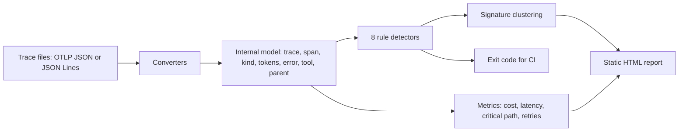

# tracefault

[](https://github.com/shreyas-tech7/tracefault/actions/workflows/ci.yml)

<!-- gen:status -->
**Status:** v0.1.0-rc1 release candidate. Numbers come from `results/final-seed2026.json` (2026-11-21, none (rule detectors, synthetic traces), seed 2026).
<!-- /gen:status -->

tracefault reads agent traces and finds the runs that went wrong, and why. It looks for eight failure types, groups the failures by signature and writes a static HTML report. `tracefault scan` exits with code 1 when it finds a failure, so it can gate a CI job.

## The problem

Your agent works in the demo. In production it loops on a failing tool, calls the same tool with the same arguments again and again, runs out of context, picks a tool that has nothing to do with the task, waits on a tool that never answers or burns through its token budget. The traces hold all of this. Nobody has time to read every trace.

OpenTelemetry now has GenAI semantic conventions for model calls, tools and agents. Every `gen_ai.*` span, metric and attribute is still at Development status, so field names can change. tracefault reads that format and a plain JSON Lines format, runs rule detectors with stated thresholds and tells you which runs failed and how.

## How it works



1. Read the trace files. Each file is OTLP JSON (one export, or one export per line) or JSON Lines with one span per line.
2. Convert both to one internal model.
3. Run the eight detectors. Each one is a rule with a stated threshold. No model is in the loop.
4. Cluster the findings by a signature: the failure type, the normalized error text and the last three tool names before the failing span.
5. Compute the metrics for each trace.
6. Write the report and set the exit code.

The detectors and their thresholds:

<!-- gen:rules -->
| Detector | Fires when | Threshold source |
| --- | --- | --- |
| `tool_error_loop` | 3 or more tool errors in a row | tuned on seed 1 |
| `repeated_calls` | one tool gets the same arguments 3 or more times, all successful | tuned on seed 1 |
| `context_overflow` | model input at 0.85 of the limit or more, then a `length` finish or the next input under 0.6 of it | tuned on seed 1 |
| `wrong_tool` | 2 or more calls to known tools outside the task list | tuned on seed 1 |
| `timeout` | a tool call lasts 1 times the timeout or longer, or `error.type` is `timeout` | tuned on seed 1 |
| `budget_exhaustion` | tokens reach 1 times the budget | tuned on seed 1 |
| `unknown_tool` | one call to a tool missing from `gen_ai.tool.definitions` | fixed (one event) |
| `handoff_drop` | one required field missing, null or empty in the handoff payload | fixed (one event) |
<!-- /gen:rules -->

Limits come from the root span. The GenAI conventions define no limit attributes, so tracefault uses its own: `tracefault.context_limit`, `tracefault.budget_tokens`, `tracefault.timeout_s`, `tracefault.tools.allowed`, plus `tracefault.handoff.required` and `tracefault.handoff.payload` on a handoff span. The list of tools that exist comes from the convention's `gen_ai.tool.definitions`. When a trace leaves a limit out, its detector falls back to the error text or skips. See [examples/otel_genai.json](examples/otel_genai.json).

<!-- gen:otel -->
Field names are pinned to: open-telemetry/semantic-conventions-genai main branch, docs/gen-ai/gen-ai-spans.md and gen-ai-agent-spans.md fetched 2026-11-21 (core conventions v1.45.0 links). Status: Development.
<!-- /gen:otel -->

## Results

The failures in this benchmark are planted by a generator. Real traces can fail in other ways. The generator and the rules were written by the same agent, so a high score here shows that the rules catch the faults as the generator plants them. It does not show how they do on your traces.

Clean traces carry benign noise on purpose: one retry after a tool error, two identical status polls (rarely three), one exploratory call outside the task list, slow calls that still finish in time, a context near its limit without truncation, a summary step that shrinks the context, and spend close to the budget without reaching it.

<!-- gen:noise -->
Two generator settings shape these numbers. Clean traces spend up to 97 percent of the budget (`CLEAN_SPEND_MAX`). About 15 percent of traces leave out one declared limit (`MISSING_P`). Both live in `src/tracefault/generate.py`. They are settings, not results.
<!-- /gen:noise -->

<!-- gen:results -->
Run of 2026-11-21, model: none (rule detectors, synthetic traces), held-out seed 2026, file `results/final-seed2026.json`.
1600 traces: 1200 with one planted failure (150 per type) and 400 clean. Thresholds were tuned on seed 1 only (`results/tune-seed1.json`).

| Failure (planted by the generator) | Precision, 95% CI | Recall, 95% CI | TP / FP / FN |
| --- | --- | --- | --- |
| tool error loop | 150/154 = 97.4% (93.5 to 99.0) | 150/150 = 100.0% (97.5 to 100.0) | 150 / 4 / 0 |
| identical repeated calls | 150/168 = 89.3% (83.7 to 93.1) | 150/150 = 100.0% (97.5 to 100.0) | 150 / 18 / 0 |
| context overflow | 150/154 = 97.4% (93.5 to 99.0) | 150/150 = 100.0% (97.5 to 100.0) | 150 / 4 / 0 |
| wrong tool for the task | 93/96 = 96.9% (91.2 to 98.9) | 93/150 = 62.0% (54.0 to 69.4) | 93 / 3 / 57 |
| timeout | 150/151 = 99.3% (96.3 to 99.9) | 150/150 = 100.0% (97.5 to 100.0) | 150 / 1 / 0 |
| budget exhaustion | 149/149 = 100.0% (97.5 to 100.0) | 149/150 = 99.3% (96.3 to 99.9) | 149 / 0 / 1 |
| call to a tool that does not exist | 150/150 = 100.0% (97.5 to 100.0) | 150/150 = 100.0% (97.5 to 100.0) | 150 / 0 / 0 |
| handoff drops a required field | 150/150 = 100.0% (97.5 to 100.0) | 150/150 = 100.0% (97.5 to 100.0) | 150 / 0 / 0 |

Clean traces flagged by any detector: 6/400 = 1.5% (0.7 to 3.2).
Faulty traces flagged by any detector: 1142/1200 = 95.2% (93.8 to 96.2).
Clustering put 1172 findings into 402 signature clusters. Cluster purity (the share of a cluster's traces whose planted failure matches the cluster's type): 1142/1172 = 97.4% (96.4 to 98.2).

Second check on seed 7 (file `results/second-seed7.json`), because several rows sit near 100%:

| Failure | Precision, 95% CI | Recall, 95% CI |
| --- | --- | --- |
| tool error loop | 150/159 = 94.3% (89.6 to 97.0) | 150/150 = 100.0% (97.5 to 100.0) |
| identical repeated calls | 150/175 = 85.7% (79.8 to 90.1) | 150/150 = 100.0% (97.5 to 100.0) |
| context overflow | 150/156 = 96.2% (91.9 to 98.2) | 150/150 = 100.0% (97.5 to 100.0) |
| wrong tool for the task | 105/105 = 100.0% (96.5 to 100.0) | 105/150 = 70.0% (62.2 to 76.8) |
| timeout | 150/150 = 100.0% (97.5 to 100.0) | 150/150 = 100.0% (97.5 to 100.0) |
| budget exhaustion | 149/149 = 100.0% (97.5 to 100.0) | 149/150 = 99.3% (96.3 to 99.9) |
| call to a tool that does not exist | 149/149 = 100.0% (97.5 to 100.0) | 149/150 = 99.3% (96.3 to 99.9) |
| handoff drops a required field | 150/150 = 100.0% (97.5 to 100.0) | 150/150 = 100.0% (97.5 to 100.0) |

Intervals are Wilson 95% score intervals over traces. A trace counts for a type when that detector fires anywhere in it.
<!-- /gen:results -->

<!-- gen:tradeoff -->
The alert trade-off shows in two rows. `wrong_tool` waits for 2 calls outside the task list, because clean runs sometimes make one exploratory call. That keeps false alarms low and costs recall, since many planted wrong-tool runs make only one bad call. `repeated_calls` fires at 3 identical calls, so the rare clean run that polls a status that often becomes a false alarm.
<!-- /gen:tradeoff -->

## Cost per task

<!-- gen:cost -->
Cost per task: $0.00. tracefault calls no model and no API.
The held-out bench (1600 traces, both converters, eight detectors and clustering) took 0.83 s on 1 core of an Intel(R) Xeon(R) Processor @ 2.10GHz (pinned with `taskset -c 0`), Python 3.11.18, on 2026-11-21. That is about 0.52 ms per trace.
<!-- /gen:cost -->

## Run it in 10 minutes

You need Python 3.11 or newer and git. No key, no account and no network after the install.

```bash
git clone https://github.com/shreyas-tech7/tracefault.git
cd tracefault
./init.sh                       # venv, install, lint, link check, all tests offline
.venv/bin/tracefault demo       # generate 20 traces, scan them, write a report
.venv/bin/tracefault scan examples/otel_genai.json --html report.html
echo "exit code: $?"            # 1, because the example holds a tool error loop
```

Scan your own traces:

```bash
.venv/bin/tracefault scan my-traces/*.jsonl --html report.html --json findings.json
.venv/bin/tracefault scan export.json --fail-on tool_error_loop,timeout   # only these types fail CI
```

Exit codes:

| Code | Meaning |
| --- | --- |
| 0 | The scan finished and found no failure (or none of the types named in `--fail-on`) |
| 1 | The scan finished and found at least one failure |
| 2 | Usage error, a trace file that cannot be read or parsed, or an input with no spans |

Rebuild the numbers:

```bash
.venv/bin/tracefault tune --write-thresholds      # seed 1 only
.venv/bin/tracefault bench --seed 2026 --out results/final-seed2026.json
.venv/bin/tracefault bench --seed 7 --out results/second-seed7.json
.venv/bin/tracefault readme                       # rewrites the number blocks in this file
```

A results page that opens from disk is in [docs/index.html](docs/index.html). An example scan report is in [docs/report-example.html](docs/report-example.html). A real terminal session is in [docs/DEMO.md](docs/DEMO.md).

## Limits

- The benchmark failures come from a generator. The rules and the generator share assumptions, so these numbers are an upper bound for traces that look like the generated ones.
- One planted failure per faulty trace. Real runs often fail in two ways at once.
- Several detectors need limits that most tracers do not record today. Without `tracefault.tools.allowed`, the wrong tool detector skips the trace.
- The OTel GenAI conventions are at Development status. Field names can change. The pin is below the rules table.
- Signature clustering splits failures that differ only in tool names. Clustering with small embeddings is not shipped, because the model download host was blocked when this was built.
- Cost needs a price table you pass with `--prices`. tracefault ships no prices, because prices change.
- No server, no live ingestion, no database and no LLM judge. That is by design.

## Glossary

- **Trace:** the record of one agent run, made of spans.
- **Span:** one timed step, such as a model call or a tool call, with a parent span.
- **OTLP JSON:** the JSON form of an OpenTelemetry trace export.
- **Precision:** of the traces a detector flags, the share that really hold that failure.
- **Recall:** of the traces that hold a failure, the share the detector flags.
- **95% CI:** the Wilson score interval. If the run were repeated many times, about 95% of such intervals would hold the true rate.
- **Held-out seed:** a random seed never used while tuning the thresholds.
- **Critical path:** the chain of spans that set when the trace ended.
- **Development status:** an OpenTelemetry label for conventions that can still change without notice.

## Related work

Langfuse, Arize Phoenix, LangSmith and AgentOps are tracing platforms, hosted or self-hosted, with dashboards and search. The MAST study offers a taxonomy of multi-agent failures ([arXiv 2503.13657](https://arxiv.org/abs/2503.13657)). The OpenTelemetry GenAI semantic conventions define the span format ([explainer](https://www.dash0.com/knowledge/opentelemetry-genai-semantic-conventions-explained)). tracefault is offline and file-based. It ships a planted-failure benchmark with measured detectors, and it fits in a CI step.

## How this was built

AI agents wrote most of the code under Shreyas's direction. The full brief is in [docs/build/BUILD_PROMPT.md](docs/build/BUILD_PROMPT.md). Choices are in [DECISIONS.md](DECISIONS.md) and blockers in [BLOCKERS.md](BLOCKERS.md). A study guide is in [docs/WALKTHROUGH.md](docs/WALKTHROUGH.md) and interview answers in [docs/INTERVIEW_QA.md](docs/INTERVIEW_QA.md).

Human checks, not done yet:

- Shreyas reads the diff and the detector rules.
- Shreyas runs `tracefault scan` on traces from a real agent.
- Shreyas checks the numbers against `results/final-seed2026.json`.

License: MIT. See [LICENSE](LICENSE).
